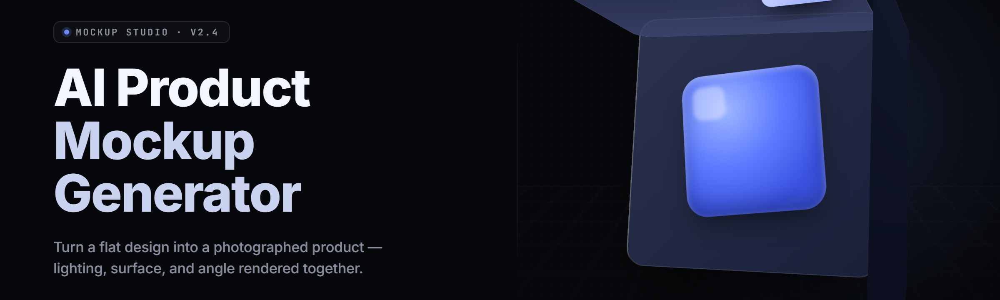

  
  
  

  

  
  

---

**The 2026 desktop mockup engine that turns a prompt into a shelf-ready product shot — packaging, hero renders, lifestyle scenes, and print-ready exports, all from one `.exe`.**

---

## 🧊 Table of Contents

- [Overview](#-overview)
- [What is AI Product Mockup Studio](#-what-is-ai-product-mockup-studio)
- [The Problem](#-the-problem)
- [The Solution](#-the-solution)
- [Quick Start](#-quick-start)
- [Key Features](#-key-features)
- [Comparison](#-comparison)
- [Grouped Module Catalog](#-grouped-module-catalog)
  - [🎨 Render & Scene Engine](#-render--scene-engine)
  - [📦 Packaging & Label Composer](#-packaging--label-composer)
  - [🧠 Generative Prompt Layer](#-generative-prompt-layer)
  - [🖨️ Export & Print Pipeline](#-export--print-pipeline)
  - [🖥️ Studio Shell & Workflow](#-studio-shell--workflow)
- [System Requirements](#-system-requirements)
- [Installation](#-installation)
- [All Modules Status](#-all-modules-status)
- [Usage Guidelines](#-usage-guidelines)
- [Known Issues](#-known-issues)
- [FAQ](#-faq)
- [Changelog](#-changelog)

---

## 🧊 Overview

AI Product Mockup Studio is a Windows desktop application for designers, indie founders, and print shops who need product visuals fast. Type a prompt, drop a flat label, pick a scene, and the studio composes a photoreal mockup — cans, bottles, boxes, pouches, tubes, apparel, and devices — then exports to PNG, PSD-layered, or print-ready PDF.

| Category | Details |
| --- | --- |
| Product type | Offline desktop mockup generator (Windows `.exe`) |
| Core engine | Diffusion renderer + parametric 3D scene graph |
| Scene library | 31 built-in environments (studio, kitchen, shelf, street, gym, bathroom) |
| Output formats | PNG, JPEG, WebP, layered PSD, TIFF, print PDF |
| AI layer | Local prompt compiler + optional cloud upscale pass |
| License | MIT — free for commercial mockup work |
| Current version | v2.4.1 (2026 release channel) |

---

## 🧊 What is AI Product Mockup Studio

A glossary of the terms you'll see in the UI, so the first launch isn't a guessing game.

| Term | Explanation |
| --- | --- |
| **Prompt Compiler** | Translates a plain-language description into a structured scene + lighting + material spec before rendering. |
| **Scene Graph** | The parametric 3D layout behind every mockup — camera, surfaces, props, and light rigs. |
| **Label Warp** | Bends a flat label PNG onto a curved surface (can, bottle, tube) with correct perspective and highlight rolloff. |
| **Matte Pass** | A cutout mask generated alongside each render for compositing into other tools. |
| **Render Preset** | A saved bundle of scene, camera, light rig, and output size — the fast path to repeatable shots. |
| **Upscale Pass** | An optional 2× or 4× detail pass that runs locally or via the cloud bridge. |
| **Batch Queue** | The job list that renders dozens of variants overnight or on a workstation. |

Benefits of the studio approach:

- Every mockup is a saved, editable recipe — not a one-off image you can't touch again.
- Labels stay sharp at print size because the renderer works from vectors and high-res sources.
- The scene graph is parametric, so swapping a can for a bottle is a dropdown, not a redraw.
- Batch rendering means one label → forty shelf variants before lunch.
- Nothing phones home unless you turn on the cloud upscale pass.

---

## 🧊 The Problem

Generic mockup workflows break in the same places, every time.

- Stock mockup PSDs are rigid — you fight smart objects for an hour to fit a label that isn't the shape the template expects.
- Online mockup tools gate every export behind a watermark or a subscription, and your client's bottle art ends up on someone else's server.
- AI image generators hallucinate packaging — text melts, edges wobble, and the label says "PRODCT."
- Print shops need bleed, CMYK, and 300 DPI, and screenshot-based mockups never survive the transition.
- Batch work is brutal — fifty SKUs means fifty manual swaps, or fifty separate renders you can't align.
- Lifestyle scenes (a can on a counter, a box on a doorstep) are the hardest to fake convincingly.
- Every tool wants a browser, an account, and a network connection to do a job that should run on your own machine.

---

## 🧊 The Solution

| Problem | Solution in AI Product Mockup Studio |
| --- | --- |
| Rigid smart-object PSDs | Parametric scene graph — drop a label, pick a surface, done |
| Watermarked online tools | Fully offline desktop `.exe`, no account, no watermark |
| Hallucinated packaging text | Label Warp composites your real artwork instead of generating letters |
| Print-shop rejection | Native CMYK + bleed + 300 DPI PDF export |
| Batch SKU grind | Batch Queue renders the whole catalog unattended |
| Fake lifestyle shots | 31 scene presets with real light rigs and shadow contact |
| Cloud dependency | Local renderer; cloud upscale is opt-in |

---

## 🧊 Quick Start

1. 🧷 **Grab the release** — head to the project page and pull the latest Windows build.
2. 📂 **Extract the archive** — right-click, Extract All, drop it somewhere you own.
3. ▶️ **Run the `.exe`** — double-click, let the first-launch scene library unpack.
4. 🎬 **Pick a scene and drop your label** — drag a PNG onto the surface, hit Render.
5. 💾 **Export** — choose PNG for web, layered PSD for edit, or CMYK PDF for print.

### ⬇️ Download

  

---

## 🧊 Key Features

| Feature | Description | Benefit |
| --- | --- | --- |
| Prompt Compiler | Turns a sentence into scene + light + material spec | Skip the manual scene fiddling |
| 31 Scene Presets | Studio, kitchen, shelf, street, gym, bathroom, more | Realistic context in one click |
| Label Warp | Bends flat art onto curved surfaces | Print-sharp text, no melt |
| Matte Pass | Auto cutout beside every render | Drop into any compositor |
| Layered PSD Export | Every element on its own layer | Client revisions without a re-render |
| Batch Queue | Render dozens of variants unattended | Scale a catalog overnight |
| CMYK Print PDF | Bleed, crop marks, 300 DPI | Survives a real print shop |
| Render Presets | Save and reload full setups | Repeatable brand shots |
| Cloud Upscale Bridge | Optional 2×/4× detail pass | Print-size detail when you need it |
| A/B Variant Grid | Side-by-side scene compare | Pick the winner fast |
| Colorway Swapper | Recolor packaging in one move | Multi-flavor line in minutes |
| Version Snapshots | Roll back any mockup state | No lost work |

---

## 🧊 Comparison

| Aspect | Stock PSD Templates | Web Mockup Tools | AI Product Mockup Studio |
| --- | --- | --- | --- |
| Runs offline | ✅ | ❌ | ✅ |
| No watermark | ✅ | ❌ | ✅ |
| Editable recipe | ❌ | Partial | ✅ |
| Print-ready CMYK | ❌ | ❌ | ✅ |
| Batch rendering | ❌ | ❌ | ✅ |
| Label Warp precision | Manual | Limited | Automatic |
| Account required | ❌ | ✅ | ❌ |
| Cost model | Per-pack | Subscription | Free (MIT) |

---

## 🧊 Grouped Module Catalog

The studio ships 31 modules across five domains. Each ships as a discrete unit inside the `.exe`.

### 🎨 Render & Scene Engine

- **Scene Graph Core** — parametric 3D layout: camera, surfaces, props, light rigs.
- **Diffusion Renderer** — the generative core that fills background and lighting.
- **Light Rig Presets** — softbox, window, golden hour, studio strobe, neon.
- **Shadow Contact Solver** — realistic contact shadows and ambient occlusion.
- **Camera Orbit Tool** — drag to reframe any preset without re-rendering the graph.
- **Depth-of-Field Control** — focal length, aperture, and bokeh shaping.
- **Material Library** — brushed metal, matte kraft, glossy PET, frosted glass, fabric.

### 📦 Packaging & Label Composer

- **Label Warp** — bends flat art onto cans, bottles, tubes, pouches.
- **Box Unfold Mapper** — maps a flat dieline onto a 3D carton with correct edges.
- **Die-Line Importer** — reads standard dielines from vector sources.
- **Foil & Emboss Simulator** — metallic and raised finishes with highlight rolloff.
- **Barcode & QR Placer** — positions scannable codes with quiet-zone checks.
- **Net-Content Text Engine** — auto-fits legal block text to the label area.
- **Pouch Crimp Renderer** — seal crimps, gussets, and stand-up geometry.

### 🧠 Generative Prompt Layer

- **Prompt Compiler** — plain language → structured scene spec.
- **Style Preset Bank** — clean e-comm, editorial, moody, minimal, retro.
- **Negative Prompt Guard** — blocks the usual artifact suspects before render.
- **Seed Locker** — freeze a look and re-roll only the scene.
- **Variant Generator** — six stylistic takes on the same prompt in one pass.
- **Prompt History** — searchable log of every spec you've built.

### 🖨️ Export & Print Pipeline

- **PNG / JPEG / WebP Export** — web-ready output with size presets.
- **Layered PSD Writer** — element-separated layers for compositing.
- **CMYK Print PDF** — bleed, crop marks, 300 DPI, ICC profile pick.
- **Matte Pass Export** — alpha cutout beside every render.
- **Batch Queue** — unattended render list with per-job output rules.
- **Naming Macro Engine** — token-based filenames for batch exports.

### 🖥️ Studio Shell & Workflow

- **Project Workspace** — saved recipes, assets, and version snapshots.
- **Colorway Swapper** — recolor packaging across a whole catalog.
- **A/B Variant Grid** — compare scenes side by side and pick a winner.
- **Cloud Upscale Bridge** — opt-in 2×/4× detail pass.
- **Snapshot Timeline** — roll back any mockup to a prior state.

---

## 🧊 System Requirements

| Component | Minimum | Recommended |
| --- | --- | --- |
| OS | Windows 10 64-bit | Windows 11 64-bit |
| CPU | Quad-core 2.5 GHz | 8-core 3.5 GHz+ |
| RAM | 8 GB | 32 GB |
| GPU | DirectX 12, 4 GB VRAM | NVIDIA RTX / AMD RX, 12 GB VRAM |
| Disk | 6 GB free | 40 GB SSD (scene cache + renders) |
| Display | 1920×1080 | 2560×1440 or higher |
| Runtime | VC++ 2019+ redistributable | Latest VC++ redistributable |

---

## 🧊 Installation

1. **Download the release archive** from the project page using the download macro above.
2. **Extract** the archive to a folder you control — avoid Program Files so the scene cache can write freely.
3. **Run the `.exe`** — on first launch it unpacks the 31-scene library and builds the shader cache (takes a minute or two on SSD).

No installer, no admin rights, no command line. Everything the studio needs lives in the extracted folder.

---

## 🧊 All Modules Status

| Module | Status | Description |
| --- | --- | --- |
| Scene Graph Core | ✅ Working | Parametric scene layout engine |
| Diffusion Renderer | ✅ Working | Generative fill + lighting core |
| Light Rig Presets | ✅ Working | Five built-in rig families |
| Shadow Contact Solver | ✅ Working | Contact shadow + AO pass |
| Camera Orbit Tool | ✅ Working | Reframe presets live |
| Depth-of-Field Control | ✅ Working | Focal, aperture, bokeh shaping |
| Material Library | ✅ Working | Seven surface materials |
| Label Warp | ✅ Working | Curved-surface label mapping |
| Box Unfold Mapper | ✅ Working | Dieline → 3D carton |
| Die-Line Importer | ✅ Working | Vector dieline ingestion |
| Foil & Emboss Simulator | ✅ Working | Metallic + raised finishes |
| Barcode & QR Placer | ✅ Working | Scannable code placement |
| Net-Content Text Engine | ✅ Working | Legal block auto-fit |
| Pouch Crimp Renderer | ✅ Working | Seal + gusset geometry |
| Prompt Compiler | ✅ Working | Language → scene spec |
| Style Preset Bank | ✅ Working | Five style families |
| Negative Prompt Guard | ✅ Working | Artifact pre-filter |
| Seed Locker | ✅ Working | Freeze + re-roll control |
| Variant Generator | ✅ Working | Six takes per prompt |
| Prompt History | ✅ Working | Searchable spec log |
| PNG / JPEG / WebP Export | ✅ Working | Web export presets |
| Layered PSD Writer | ✅ Working | Element-separated layers |
| CMYK Print PDF | ✅ Working | Bleed + crop + 300 DPI |
| Matte Pass Export | ✅ Working | Alpha cutout per render |
| Batch Queue | ✅ Working | Unattended render list |
| Naming Macro Engine | ✅ Working | Token-based filenames |
| Project Workspace | ✅ Working | Recipes + assets + versions |
| Colorway Swapper | ✅ Working | Catalog-wide recolor |
| A/B Variant Grid | ✅ Working | Side-by-side compare |
| Cloud Upscale Bridge | ✅ Working | Opt-in 2×/4× detail |
| Snapshot Timeline | ⚠️ Beta | Roll back mockup state |

---

## 🧊 Usage Guidelines

| Allowed | Not allowed |
| --- | --- |
| Commercial client mockups | Reselling the studio itself as your own product |
| Print-shop production files | Redistributing the scene library standalone |
| Batch catalog renders | Removing license headers from the `.exe` |
| Personal and studio projects | Claiming the render engine as your IP |
| Labeling your own branded products | Using the studio to fake competitor packaging |

---

## 🧊 Known Issues

| Issue | Solution |
| --- | --- |
| First launch shader cache is slow | Let it finish once — subsequent launches are instant |
| Layered PSD opens flat in old editors | Use Photoshop 2020+ or Affinity Photo 2+ |
| CMYK PDF looks dull on screen | Expected — switch to sRGB preview for screen work |
| Batch Queue stalls on network drives | Render to a local folder, copy after |
| Cloud Upscale fails behind strict firewalls | Disable the bridge or allow the listed endpoint |
| Large scene cache eats disk | Set cache folder to a big SSD in Preferences |

---

## 🧊 FAQ

| Question | Answer |
| --- | --- |
| Is it really offline? | Yes — the renderer runs entirely on your machine. Cloud upscale is opt-in and off by default. |
| Do I need an account? | No account, no sign-in, no telemetry. |
| What formats can I import? | PNG, JPEG, WebP, SVG, and standard PDF dielines. |
| Can it do print-ready output? | Yes — CMYK PDF with bleed, crop marks, and 300 DPI. |
| How many scenes ship? | 31 built-in environments, plus custom scene saving. |
| Does it need a GPU? | Minimum is DirectX 12 with 4 GB VRAM; a 12 GB card makes batch work painless. |
| Can I batch a whole catalog? | Yes — the Batch Queue renders unattended with per-job output rules. |
| Is the license commercial-friendly? | MIT — use it for client and commercial mockup work freely. |
| Where are projects stored? | In the workspace folder you choose on first launch. |
| Can I recover lost work? | Yes — the Snapshot Timeline rolls back any mockup state. |

---

## 🧊 Changelog

- **v2.4.1** — Pouch Crimp Renderer accuracy pass; CMYK PDF ICC picker.
- **v2.4.0** — Added Colorway Swapper and A/B Variant Grid.
- **v2.3.2** — Faster shader cache build; fixed Box Unfold edge seams.

---

AI Product Mockup Studio exists because a label deserves a real shelf, not a watermarked placeholder. Every scene is parametric, every export is editable, and the whole thing runs on the machine in front of you. Drop a label, pick a scene, ship the shot.

  

